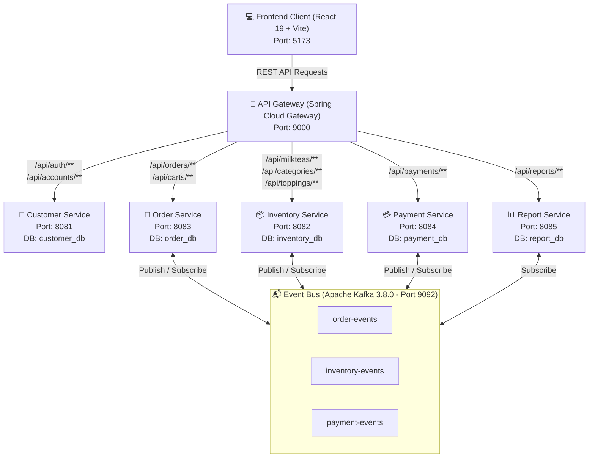
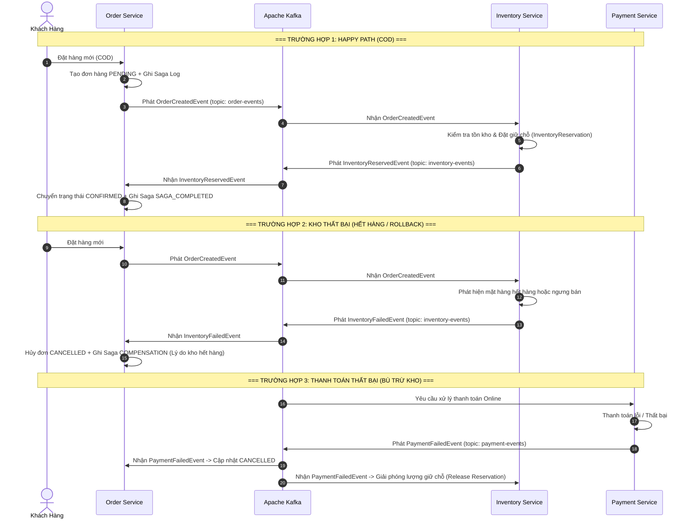

# 🧋 Shop_MilkTea — Mô Tả Toàn Diện Dự Án

> **Tên dự án:** Shop_MilkTea — Hệ thống đặt hàng trà sữa trực tuyến phân tán (Microservices)  
> **Môn học:** MSS301 — Kiến trúc Hướng Dịch vụ (Service-Oriented Architecture & Microservices)  
> **Sinh viên thực hiện:** Nguyễn Thành Long  
> **Mã số sinh viên:** DE190477  
> **Trường:** Đại học FPT  
> **Nhánh Git hiện tại:** `feature/reportService` (đã chuẩn hóa Frontend & phân lập Database cho Report Service)  
> **Thư mục gốc:** `D:\git\MSS301_DE190477_NguyenThanhLong\DE190477_MSS301_project`

---

## 1. Tổng Quan Dự Án

**Shop_MilkTea** là một hệ thống thương mại điện tử chuyên biệt cho mô hình chuỗi cửa hàng bán lẻ trà sữa trực tuyến. Dự án được thiết kế và triển khai theo **Kiến trúc Microservices** kết hợp với **Kiến trúc Hướng Sự Kiện (Event-Driven Architecture — EDA)**.

Hệ thống giải quyết bài toán giao dịch phân tán phức tạp giữa các dịch vụ độc lập (Đặt hàng — Kho bãi — Thanh toán) bằng cách áp dụng **Mô hình Saga (Saga Choreography Pattern)** thông qua message broker **Apache Kafka**, đảm bảo tính toàn vẹn và tính nhất quán dữ liệu (Data Consistency & Compensation) giữa các microservice.

Dự án phục vụ mục đích học tập và nghiên cứu, minh họa đầy đủ các khái niệm: Database-per-Service, API Gateway, JWT Authentication, Event Sourcing/Saga, CQRS, Lazy Loading, Code Splitting và tối ưu hiệu năng frontend.

---

## 2. Mục Tiêu & Phạm Vi

- Xây dựng một hệ thống bán trà sữa trực tuyến hoàn chỉnh với hai phân hệ: **Khách hàng** và **Quản trị/Admin**.
- Áp dụng kiến trúc Microservices với phân tách cơ sở dữ liệu độc lập cho từng service (Database-per-Service).
- Minh họa giao dịch phân tán qua Saga Choreography + Apache Kafka (bao gồm cả happy path và compensation/rollback).
- Cung cấp Dashboard báo cáo kinh doanh thời gian thực cho quản trị viên.
- Tối ưu trải nghiệm người dùng và hiệu năng ứng dụng frontend (React 19 + Vite 8).

---

## 3. Tính Năng Chính

### 3.1. Phân Hệ Khách Hàng (Customer Experience)

- **Trang chủ & Giới thiệu:** Giao diện hiện đại, tối ưu trải nghiệm, tương thích đa thiết bị.
- **Thực đơn linh hoạt:**
  - Xem danh mục sản phẩm, tìm kiếm và lọc đồ uống.
  - Tùy chỉnh kích cỡ (Nhỏ, Vừa, Lớn) với công thức tính giá theo tỷ lệ size.
  - Tùy chọn nhiều loại Topping ăn kèm (Trân châu đen, Pudding, Thạch củ năng, ...).
- **Giỏ hàng thời gian thực:** Quản lý số lượng, tự động tính tổng tiền theo kích cỡ và topping.
- **Quy trình đặt hàng & Thanh toán:** Hỗ trợ COD hoặc thanh toán trực tuyến (VNPay sandbox).
- **Tra cứu đơn hàng:** Lịch sử đơn hàng cá nhân và trạng thái xử lý theo thời gian thực.
- **Xác thực & Bảo mật:** Đăng nhập/đăng ký với cơ chế JWT Token.

### 3.2. Phân Hệ Quản Trị Viên (Admin Portal)

- **Dashboard & Báo cáo thống kê:**
  - Tổng quan doanh thu, số lượng đơn hàng, tỷ lệ chuyển đổi, đơn hủy.
  - Biểu đồ xu hướng doanh thu theo mốc thời gian.
  - Thống kê Top đồ uống bán chạy (Top-selling products).
  - Phân tích cơ cấu phương thức thanh toán và trạng thái đơn hàng.
- **Quản lý Thực đơn & Kho hàng (Menu & Inventory):**
  - Quản lý danh mục (Categories), sản phẩm trà sữa (MilkTeas), kích cỡ (Sizes), Toppings.
  - Quản lý trạng thái mở bán/ngưng bán, cập nhật giá và thông tin món.
- **Quản lý Đơn hàng & Saga Logs:**
  - Theo dõi danh sách đơn hàng toàn hệ thống với bộ lọc trạng thái đa chiều.
  - **Saga Logs Monitor:** Giám sát chi tiết chuỗi sự kiện giao dịch phân tán Saga theo từng bước (`RESERVE_INVENTORY`, `PROCESS_PAYMENT`, `COMPENSATION`, `SAGA_COMPLETED`).
- **Quản lý Người dùng & Tài khoản:**
  - Quản lý danh sách tài khoản khách hàng và nhân viên.
  - Khóa/Kích hoạt tài khoản, quản lý vai trò (`ADMIN`, `STAFF`, `CUSTOMER`).
- **Màn hình POS tại quầy (Staff):** `/staff/pos` cho nhân viên gọi món cho khách tại cửa hàng.

---

## 4. Kiến Trúc & Công Nghệ

### 4.1. Tech Stack

| Lớp | Công nghệ |
|---|---|
| Backend Framework | Java 21, Spring Boot 4.1.x, Spring Cloud Gateway (WebMVC) |
| Database & Persistence | MySQL 8.4, Spring Data JPA, Hibernate, Flyway Migration |
| Message Broker | Apache Kafka 3.8 (KRaft mode, không Zookeeper) |
| Security | Spring Security, JWT (JJWT), BCrypt |
| Frontend | React 19, Vite 8, React Router v7, Bootstrap 5 & React-Bootstrap, Axios |
| Containerization | Docker, Docker Compose, Windows Batch Scripts (`run.bat`, `stop.bat`) |
| Build Tool | Maven (mvnw), npm |

### 4.2. Sơ Đồ Kiến Trúc Tổng Thể



### 4.3. Danh Sách Microservices

| Tên Dịch Vụ | Port | Cơ Sở Dữ Liệu | Nhiệm Vụ Trọng Tâm |
|---|---:|---|---|
| **API Gateway** | `9000` | *Không có* | Định tuyến request, giải mã JWT, forward `X-User-Id`, `X-Username`, `X-User-Role`, cấu hình CORS. |
| **Customer Service** | `8081` | `customer_db` | Đăng ký, đăng nhập, phát hành JWT, quản lý tài khoản và vai trò (`ADMIN`, `STAFF`, `CUSTOMER`). |
| **Inventory Service** | `8082` | `inventory_db` | Quản lý danh mục trà sữa, sản phẩm, size, topping, kiểm soát tồn kho và giữ chỗ hàng (`InventoryReservation`). |
| **Order Service** | `8083` | `order_db` | Quản lý giỏ hàng (`Cart`), đơn hàng (`Order`), điều phối quy trình Saga và lưu vết `SagaLog`. |
| **Payment Service** | `8084` | `payment_db` | Xử lý thanh toán, lưu vết lịch sử giao dịch và bắn sự kiện thanh toán lên Kafka. |
| **Report Service** | `8085` | `report_db` | Tổng hợp số liệu, cung cấp API phân tích kinh doanh cho Dashboard (CQRS + Kafka + OpenFeign sync). |
| **Frontend Web** | `5173` | *Client SPA* | Ứng dụng giao diện người dùng React 19 + Vite cho khách hàng và phân hệ quản trị. |

---

## 5. Mô Hình Giao Dịch Phân Tán Saga (Choreography)

Hệ thống xử lý tính nhất quán dữ liệu giữa các microservice bằng **Saga Choreography Pattern** qua các Topic của Apache Kafka:



---

## 6. Phân Rã Dữ Liệu (Database-per-Service)

Mỗi service áp dụng chặt chẽ mẫu hình **Database-per-Service**, quản lý schema riêng biệt thông qua Flyway Migration. MySQL khởi tạo 5 database độc lập (`customer_db`, `inventory_db`, `order_db`, `payment_db`, `report_db`) qua `Shop_MilkTea_Service/mysql/init.sql`.

- `report-service` sở hữu riêng `report_db` (không còn truy cập trực tiếp `order_db`), đồng bộ qua CQRS (Kafka EDA + OpenFeign Sync) và endpoint quản trị `POST /api/reports/sync`.
- Các service đều dùng `spring.jpa.hibernate.ddl-auto=none` và khởi tạo bảng qua Flyway (`db/migration/V*.sql`).

---

## 7. Cấu Trúc Thư Mục Dự Án

```text
DE190477_MSS301_project/
├── run.bat                          # Script 1-click khởi động toàn bộ hệ thống
├── stop.bat                         # Script 1-click dừng toàn bộ hệ thống
├── README.md                        # Tài liệu mô tả dự án (gốc)
├── PROJECT_DESCRIPTION.md           # (file này) Mô tả toàn diện dự án
├── PROJECT_QUALITY_AUDIT_REPORT.md  # Báo cáo đánh giá chất lượng
│
├── Shop_MilkTea/                    # Frontend Application (React 19 + Vite)
│   ├── src/
│   │   ├── component/               # Reusable UI components (Navbar, Footer, Modals, Cards)
│   │   ├── context/                 # State management Context API (Auth, Cart, Order, Inventory, Report, Account)
│   │   ├── layout/                  # Master layouts (MainLayout, AdminLayout)
│   │   ├── page/                    # Các trang người dùng (Landing, Menu, Cart, Orders, Payment)
│   │   │   ├── admin/               # Các trang Admin (Dashboard, Menu, Orders, Accounts, Report)
│   │   │   └── staff/               # Staff POS
│   │   ├── router/                  # Cấu hình định tuyến React Router v7 (AppRouter, lazy loading)
│   │   ├── service/                 # Axios HTTP client gọi API qua API Gateway
│   │   ├── reduce/                  # Reducers (state)
│   │   ├── validation/              # Validation helpers
│   │   └── util/                    # Utilities (formatPrice, orderUtils)
│   ├── package.json
│   └── vite.config.js
│
└── Shop_MilkTea_Service/            # Backend Microservices (Spring Boot)
    ├── docker-compose.yml           # Khởi tạo MySQL 8.4 và Apache Kafka 3.8
    ├── mysql/
    │   └── init.sql                 # Script khởi tạo 5 database độc lập
    ├── postman/                     # Postman collection & environment
    ├── api-gateway/                 # Spring Cloud Gateway (Port 9000)
    ├── customer-service/            # Customer & Authentication Service (Port 8081)
    ├── inventory-service/           # Inventory & Catalog Service (Port 8082)
    ├── order-service/               # Order & Saga Orchestration Service (Port 8083)
    ├── payment-service/             # Payment Processing Service (Port 8084)
    └── report-service/              # Reporting & Analytics Service (Port 8085)
```

---

## 8. Hướng Dẫn Cài Đặt & Khởi Chạy

### 8.1. Yêu Cầu Môi Trường

- **Java:** JDK 21 trở lên (khuyến nghị OpenJDK 21).
- **NodeJS:** Node.js v20+ và npm.
- **Docker & Docker Compose:** Docker Desktop để chạy MySQL và Kafka.

### 8.2. Khởi Chạy Nhanh (Khuyến Nghị ⚡)

1. **Khởi động toàn bộ hệ thống (Docker + 5 Backend Services + Frontend):**
   ```cmd
   run.bat
   ```
   Kịch bản tự động:
   - Khởi động Docker containers (MySQL 8.4 cổng 3306, Apache Kafka cổng 9092).
   - Kiểm tra cổng mạng cho đến khi database và message broker sẵn sàng.
   - Lần lượt khởi động `customer-service`, `inventory-service`, `order-service`, `api-gateway` và Frontend React.

2. **Dừng toàn bộ hệ thống:**
   ```cmd
   stop.bat
   ```
   Tự động giải phóng các cổng (8081, 8082, 8083, 8084, 8085, 9000, 5173) và tắt container Docker an toàn.

### 8.3. Khởi Chạy Thủ Công

#### Bước 1: Hạ tầng Docker (MySQL & Kafka)
```bash
cd Shop_MilkTea_Service
docker compose up -d
```

#### Bước 2: Microservices (mở từng terminal)
```bash
# Terminal 1: Customer Service (8081)
cd Shop_MilkTea_Service/customer-service && ./mvnw spring-boot:run

# Terminal 2: Inventory Service (8082)
cd Shop_MilkTea_Service/inventory-service && ./mvnw spring-boot:run

# Terminal 3: Order Service (8083)
cd Shop_MilkTea_Service/order-service && ./mvnw spring-boot:run

# Terminal 4: Payment Service (8084)
cd Shop_MilkTea_Service/payment-service && ./mvnw spring-boot:run

# Terminal 5: Report Service (8085)
cd Shop_MilkTea_Service/report-service && ./mvnw spring-boot:run

# Terminal 6: API Gateway (9000)
cd Shop_MilkTea_Service/api-gateway && ./mvnw spring-boot:run
```

#### Bước 3: Frontend React
```bash
cd Shop_MilkTea
npm install
npm run dev
```

---

## 9. Tài Khoản Thử Nghiệm Mặc Định

Tất cả tài khoản thử nghiệm được seed sẵn qua Flyway Migration với mật khẩu mặc định: **`password123`**

| Tên Đăng Nhập | Mật Khẩu | Vai Trò (Role) | Trạng Thái | Mô Tả |
|---|---|---|---|---|
| `admin_db` | `password123` | **ADMIN** | `ACTIVE` | Toàn quyền quản trị hệ thống, menu, đơn hàng, tài khoản, thống kê. |
| `staff1` | `password123` | **STAFF** | `ACTIVE` | Tài khoản nhân viên vận hành cửa hàng. |
| `customer1` | `password123` | **CUSTOMER** | `ACTIVE` | Tài khoản khách hàng thông thường để đặt món. |
| `customer2` | `password123` | **CUSTOMER** | `ACTIVE` | Tài khoản khách hàng kiểm thử số 2. |
| `inactive_user` | `password123` | **CUSTOMER** | `INACTIVE` | Tài khoản mô phỏng trường hợp chưa kích hoạt hoặc bị khóa. |

> Lưu ý: Backend `customer-service` còn cấu hình tài khoản in-memory `admin / admin123` (so khớp plaintext) — cần đồng bộ với script khởi động (xem báo cáo chất lượng).

---

## 10. Các Đường Dẫn Truy Cập Chính

- 🏠 **Trang Chủ Khách Hàng:** http://localhost:5173
- 📜 **Thực Đơn Món Ăn:** http://localhost:5173/menu
- 🛒 **Giỏ Hàng:** http://localhost:5173/cart
- 📦 **Lịch Sử Đơn Hàng:** http://localhost:5173/orders
- 📊 **Admin Dashboard:** http://localhost:5173/admin/dashboard
- 📋 **Admin Quản Lý Thực Đơn:** http://localhost:5173/admin/menu
- 📑 **Admin Quản Lý Đơn Hàng & Saga Logs:** http://localhost:5173/admin/orders
- 👥 **Admin Quản Lý Tài Khoản:** http://localhost:5173/admin/accounts
- 🖥️ **Staff POS:** http://localhost:5173/staff/pos
- 🌐 **API Gateway Root:** http://localhost:9000

---

## 11. Chất Lượng & Trạng Thái Hiện Tại (Tóm Tắt Từ Audit Report)

**Điểm tổng thể: 6.8 / 10** — Đang tiến triển rất tốt.

| Hạng mục | Đánh giá | Điểm | Ghi chú |
|---|---|---:|---|
| Kiến trúc Microservices | ✅ Rất tốt (đã khắc phục) | 8.0 | Database-per-service 100%; report-service có `report_db` riêng, đồng bộ CQRS (Kafka + OpenFeign). |
| Backend Code & Saga Pattern | ⚠️ Khá, còn rủi ro | 7.0 | Saga hoạt động cơ bản; thiếu lock concurrency trong trừ kho; thiếu Circuit Breaker; event deserialization duck-typing. |
| Bảo mật & Cấu hình | 🚨 Cảnh báo cao | 4.5 | Hardcode secrets (DB, JWT, VNPay); admin password plaintext; downstream service chưa chặn bypass Gateway. |
| Kiểm thử tự động | 🚨 Nghiêm trọng | 2.5 | `order-service` fail 2 NPE (chưa mock Kafka Producer) + context load fail; 4/6 service không có unit test; Frontend 0% test. |
| Frontend Code Quality | ✅ Rất tốt (đã nâng cấp) | 8.5 | 0 lỗi ESLint; Lazy Loading giảm bundle từ 728 kB → 322 kB; phân quyền `AdminRoute`/`StaffRoute`. Còn God Components > 1000 dòng. |
| DevOps & Triển khai | ⚠️ Cơ bản | 5.0 | Docker Compose chỉ chạy MySQL & Kafka; 0 Dockerfile; thiếu CI/CD; thiếu Distributed Tracing. |

### Các điểm đã hoàn thành nổi bật

- ✅ Phân lập 100% Database-per-service, chuẩn hóa Flyway.
- ✅ Report Service đồng bộ thời gian thực qua Kafka (`order-events`, `payment-events`) + OpenFeign sync; 21/21 tests PASS.
- ✅ Frontend: 0 lỗi ESLint/React Hooks; Code Splitting toàn bộ 13 trang; lazy loading ảnh.
- ✅ Phân quyền tuyến đường `AdminRoute` (chỉ ADMIN) và `StaffRoute` (STAFF/ADMIN).

### Các việc còn tồn đọng (Roadmap)

- 🔴 Fix unit test `order-service` (bổ sung mock `OrderEventProducer`, cấu hình test profile H2).
- 🔴 Đồng bộ thông tin admin giữa `run.bat` và `application.properties`.
- 🟡 Tái cấu trúc các God Component (`AdminMenuPage.jsx`, `StaffPosPage.jsx`).
- 🟡 Chống bán vượt kho: thêm `@Version`/Pessimistic Lock vào `MilkTea`.
- 🟡 Chuẩn hóa Event Contract (trường `eventType` thay vì duck-typing).
- 🟡 Bảo vệ nội bộ microservices (header bí mật `X-Gateway-Secret`).
- 🟡 Đưa secrets ra biến môi trường (`.env`).
- 🟢 Viết Dockerfile cho toàn bộ service + Frontend; nâng cấp `docker-compose.yml`.
- 🟢 Tạo Root Maven Parent POM; thiết lập GitHub Actions CI.
- 🟢 Bổ sung Unit Test bao phủ cho Customer/Inventory/Payment service; Frontend test runner (Vitest/Jest).

---

## 12. Thông Tin Tác Giả & Bản Quyền

- **Họ và tên:** Nguyễn Thành Long
- **Mã sinh viên:** DE190477
- **Học phần:** MSS301 — Kiến trúc Hướng Dịch vụ
- **Trường:** Đại học FPT
- **Bản quyền:** © 2026 DE190477 — Nguyễn Thành Long. Dự án phục vụ mục đích học tập và nghiên cứu.

---

*Tài liệu này được tổng hợp từ `README.md` và `PROJECT_QUALITY_AUDIT_REPORT.md` sau khi kiểm tra toàn bộ cấu trúc dự án (source code, cấu hình, migration, frontend, scripts).*
