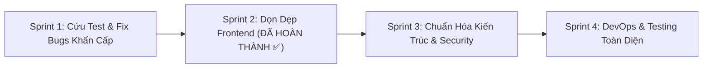

# 📊 BÁO CÁO ĐÁNH GIÁ TOÀN DIỆN CHẤT LƯỢNG DỰ ÁN (PROJECT HEALTH CHECK & AUDIT REPORT)

> **Dự án:** Shop_MilkTea - Hệ Thống Đặt Hàng Trà Sữa Trực Tuyến Microservices  
> **Môn học:** MSS301 - Kiến trúc Hướng Dịch vụ (SOA & Microservices)  
> **Sinh viên:** Nguyễn Thành Long (MSSV: DE190477)  
> **Thời điểm kiểm tra:** Tháng 10/2026  
> **Phiên bản mã nguồn hiện tại:** Git branch `frontend` (Đã chuẩn hóa Frontend & Tối ưu Lazy-Loading)  

---

## 🎯 1. BẢNG TỔNG KẾT SỨC KHỎE DỰ ÁN (QUALITY SCORECARD)

| Hạng mục kiểm tra | Đánh giá | Điểm (Thang 10) | Nhận xét cập nhật |
| :--- | :---: | :---: | :--- |
| **Kiến trúc Microservices** | ✅ **Rất Tốt (Đã Khắc Phục)** | **8.0 / 10** | **Đã phân lập 100% Database-per-service**. `report-service` sở hữu riêng `report_db`, đồng bộ qua mô hình CQRS (Kafka EDA + OpenFeign Sync). |
| **Backend Code & Saga Pattern** | ⚠️ Khá - Còn rủi ro | **7.0 / 10** | Saga hoạt động cơ bản tốt, nhưng phân giải event bằng duck-typing (kiểm tra field tồn tại); thiếu khóa đồng thời (Lock) trong trừ kho; thiếu Circuit Breaker. |
| **Bảo mật & Cấu hình** | 🚨 Cảnh báo cao | **4.5 / 10** | Hardcode mật khẩu DB, JWT secret, VNPay sandbox secret; Mật khẩu Admin in-memory so khớp plaintext; Downstream service chưa chặn bypass Gateway. |
| **Kiểm thử tự động (Unit Test)** | 🚨 Nghiêm trọng | **2.5 / 10** | `order-service` bị **Fail test** (2 lỗi NPE do chưa mock Kafka Producer); 4/6 service không có bất kỳ unit test nào; Frontend 0% test. |
| **Frontend Code Quality** | ✅ **Rất Tốt (Đã Nâng Cấp)** | **8.5 / 10** | **Đã xử lý 100% (93/93) lỗi ESLint & React Hooks Effect**; Áp dụng Lazy Loading giảm bundle chính từ **728 kB xuống 322 kB**; Tách quyền `AdminRoute` / `StaffRoute`. Còn tồn đọng: Tách nhỏ các God Component > 1.000 dòng. |
| **DevOps & Triển khai** | ⚠️ Cơ bản | **5.0 / 10** | Docker Compose chỉ chạy MySQL và Kafka; **0 Dockerfile** cho 6 services và Frontend; thiếu CI/CD GitHub Actions; thiếu Distributed Tracing. |
| **TỔNG THỂ DỰ ÁN** | 📈 **ĐANG TIẾN TRIỂN RẤT TỐT** | **6.8 / 10** | Frontend và Kiến trúc phân lập Database đã đạt chuẩn cao. Trọng tâm tiếp theo là xử lý 2 unit test mock Kafka trong `order-service` và Concurrency Lock ở kho. |

---

## 🔍 2. CHI TIẾT CÁC PHÁT HIỆN Ở PHẦN BACKEND (MICROSERVICES)

### 2.1. Kiến trúc Database-per-service: ĐÃ KHẮC PHỤC TRIỆT ĐỂ ✅
- **Hiện trạng trước đây:** `report-service` cấu hình JDBC trỏ trực tiếp sang `order_db`, phạm lỗi anti-pattern Shared Database.
- **Giải pháp CQRS & EDA đã triển khai:**
  1. **Phân lập cơ sở dữ liệu & Flyway Migration:** Cấu hình JDBC của `report-service` đã chuyển sang cơ sở dữ liệu riêng `report_db` (`spring.datasource.url=jdbc:mysql://localhost:3306/report_db`), chuẩn hóa migration tự động qua Flyway (`spring.flyway.enabled=true`, `spring.flyway.table=report_flyway_history`), cấu hình `spring.jpa.hibernate.ddl-auto=none` (khởi tạo bảng hoàn toàn qua script migration `db/migration/V1__create_report_tables.sql` thay vì để application/Hibernate tự tạo) đồng bộ chuẩn mực với toàn bộ các microservices khác (`order-service`, `inventory-service`, `payment-service`, `customer-service`).
  2. **Đồng bộ thời gian thực qua Apache Kafka (Event-Driven):**
     - Tích hợp `spring-kafka` vào `report-service`, lắng nghe các sự kiện trên topic `order-events` (`OrderCreatedEvent`, `OrderCancelledEvent`, `OrderStatusUpdatedEvent`) và `payment-events` (`PaymentSuccessEvent`, `PaymentFailedEvent`).
     - Bổ sung phát sự kiện `OrderStatusUpdatedEvent` từ `order-service` khi trạng thái đơn hàng thay đổi (đặc biệt là `COMPLETED`) để báo cáo doanh thu luôn cập nhật tức thời.
  3. **Đồng bộ dự phòng qua OpenFeign REST Client:**
     - Tích hợp `OrderClient` và `ReportSyncService`: tự động đồng bộ ban đầu khi service khởi động nếu `report_db` còn trống, và cung cấp endpoint quản trị `POST /api/reports/sync` cho phép kích hoạt đồng bộ chủ động.
  4. **Kiểm thử tự động:** Đã bổ sung 9 unit test mới (`ReportSyncServiceTest`, `ReportEventListenerTest`, mở rộng `ReportControllerTest`), nâng tổng số test của `report-service` lên **21 tests - 100% PASS**.

---

### 2.2. Lỗi Saga Choreography & Xử lý Event Broker (Apache Kafka)
1. **Event Deserialization dựa trên Duck-typing (Thiếu Event Header / Event Type):**
   - Trong `InventoryEventListener.java`:
     ```java
     if (root.has("items")) {
         OrderCreatedEvent event = objectMapper.treeToValue(root, OrderCreatedEvent.class);
     } else if (root.has("reason") && root.has("orderCode")) {
         OrderCancelledEvent event = ...
     }
     ```
   - **Rủi ro:** Không dùng thuộc tính `eventType` chuẩn hóa hoặc Kafka Record Header `__TypeId__`. Khi payload thay đổi hoặc có event mới, cơ chế `root.has(...)` rất dễ đoán sai loại event dẫn đến nuốt mất event hoặc cast lỗi.
2. **`payment-service` thiếu vai trò Event-Driven:**
   - Trong `payment-service`, chỉ có `PaymentEventProducer.java`, hoàn toàn **không có `@KafkaListener`** nào.
   - Luồng thanh toán hiện tại kích hoạt bằng REST API từ Frontend `/api/payments/create`, sau đó mới bắn event sang Kafka. Hệ thống chưa tận dụng kiến trúc hướng sự kiện toàn diện cho bước thanh toán.
3. **Thiếu Dead Letter Queue (DLQ) & Xử lý lỗi Consumer:**
   - Khi consumer gặp lỗi Deserialize hoặc Database lỗi, phương thức quăng `RuntimeException`. Kafka listener mặc định sẽ bị tắc (poison pill) nếu không cấu hình `DefaultErrorHandler` với Dead Letter Topic (DLT) để cô lập message lỗi.

---

### 2.3. Lỗ hổng Race Condition / Bán vượt tồn kho (Overselling) trong `inventory-service`
- **Hiện trạng:**
  - Entity `MilkTea.java` kế thừa `BaseEntity`, **không có trường `@Version`** (Optimistic Lock).
  - Phương thức `reserveInventory` trong `InventoryReservationService.java`:
    ```java
    MilkTea milkTea = milkTeaRepository.findById(item.getMilkTeaId()).orElseThrow();
    int newStock = milkTea.getStockQuantity() - reqQty;
    milkTea.setStockQuantity(newStock);
    milkTeaRepository.save(milkTea);
    ```
- **Hậu quả:** Khi có 2 đơn hàng gửi tới đồng thời (Concurrent Orders) cho cùng 1 món trà sữa (ví dụ khi còn 1 sản phẩm cuối cùng): Cả 2 luồng đều đọc `stockQuantity = 1`, đều trừ còn `0` và lưu lại -> Bán được 2 ly trong khi kho chỉ có 1 ly (Lost Update).
- **Giải pháp:** Bổ sung `@Version private Long version;` vào `MilkTea.java` hoặc sử dụng Pessimistic Locking `@Lock(LockModeType.PESSIMISTIC_WRITE)` trong `MilkTeaRepository.findById(...)`.

---

### 2.4. Khớp nối đồng bộ (Temporal Coupling) & Thiếu Circuit Breaker
- **Hiện trạng:**
  - Trong `OrderService.createOrder(...)`, phương thức này gọi đồng bộ qua OpenFeign sang `inventory-service`:
    - `priceVerificationService.getAllSizes()`
    - `priceVerificationService.getAllToppings()`
    - `priceVerificationService.verifyItemPrice(...)`
- **Hậu quả:** Nếu `inventory-service` bị restart, nghẽn mạng hoặc chậm chạp, toàn bộ API tạo đơn hàng của `order-service` lập tức sập theo (Cascading Failure), trả về lỗi 400 Bad Request cho người dùng.
- **Giải pháp:** Tích hợp Resilience4j (Circuit Breaker & Fallback) hoặc cơ chế Cache (Spring Cache / Redis / In-memory Caffeine) cho danh mục Sizes và Toppings vì đây là dữ liệu tĩnh ít biến động.

---

### 2.5. Lỗ hổng Bảo mật & Quản lý Thông tin nhạy cảm
1. **Lộ Secret Keys và Mật khẩu trong Git:**
   - JWT Secret: `shop-milktea-service-secret-key-2026-mss301`
   - MySQL Password: `rootpassword`
   - VNPay Credentials: `vnpay.tmn-code=7IGY7DX2`, `vnpay.hash-secret=JMPHXLCVEWAGJPAGEVKAPJRXWZRMZCZV`
   - Tất cả đang nằm dạng cleartext trong các file `application.properties` và đã được push lên Git.
2. **Cơ chế xác thực tài khoản Admin không an toàn:**
   - Trong `AuthService.java` của `customer-service`:
     ```java
     if (adminUsername.equalsIgnoreCase(request.getUsername())) {
         if (!adminPassword.equals(request.getPassword())) { ... }
         return buildResponse(0L, adminUsername, "admin@milkteashop.com", "ADMIN");
     }
     ```
   - Mật khẩu admin được so khớp chuỗi trần (`equals`), không băm BCrypt.
   - Thông tin admin cấu hình trong code là `admin / admin123`, nhưng file `run.bat` lại in ra màn hình `admin_db / password123` (gây bối rối cho người dùng và người chấm bài).
3. **Nguy cơ Bypass API Gateway (Zero Trust Violation):**
   - Gateway xóa các header `X-User-Id`, `X-User-Role` từ client gửi vào và gán lại từ JWT hợp lệ.
   - Tuy nhiên, các service bên trong (8081, 8082, 8083, 8084, 8085) chạy công khai trên localhost mà **không yêu cầu bất kỳ Secret Header** nội bộ nào (`X-Internal-Gateway-Key`). Kẻ tấn công có thể gửi request trực tiếp tới `http://localhost:8083` với header `X-User-Role: ADMIN` để chiếm quyền điều khiển hoàn toàn mà không cần token JWT!

---

### 2.6. Trùng lặp mã nguồn & Thiếu Root Maven Parent POM
- Không có file `pom.xml` ở thư mục gốc `Shop_MilkTea_Service`. Mỗi service là một project Maven riêng lẻ, không thể quản lý dependency version tập trung hay build chung 1 lệnh.
- Trùng lặp code (Copy-Paste) ở nhiều vị trí:
  - `BaseEntity.java` được sao chép ở 4 service.
  - `AuditHeaderInterceptor.java` và `AuditContext.java` được sao chép ở 5 service.
  - Các Event DTO (`OrderCreatedEvent`, `PaymentSuccessEvent`...) bị khai báo lặp lại ở nhiều bên.

---

## 💻 3. CHI TIẾT TÌNH TRẠNG PHẦN FRONTEND (`Shop_MilkTea`)

### 3.1. Đã Khắc Phục Triệt Để: 93 lỗi ESLint & React Hooks Effect ✅
- **Kết quả kiểm tra hiện tại:** Chạy `npm run lint` đạt **0 lỗi, 0 cảnh báo (Exit code 0)**.
- **Các hạng mục đã xử lý dứt điểm:**
  1. **Lỗi `react-hooks/set-state-in-effect` (Cascading Renders):**
     - `src/component/auth/LoginModal.jsx`: Loại bỏ `useEffect`, chuyển toàn bộ logic reset form sang sự kiện `onShow` của Bootstrap Modal.
     - `src/page/PaymentReturnPage.jsx`: Khởi tạo state từ search params và thực hiện đồng bộ IPN bất đồng bộ với cleanup flag `isMounted`.
     - `src/component/landing/ProductDetailModal.jsx`: Chuyển reset kích cỡ/topping sang `onShow` của Modal.
     - `src/page/PaymentPage.jsx`: Bổ sung dependency `location.state` và dọn dẹp render cycle.
  2. **Dọn sạch 91 lỗi `no-unused-vars`:**
     - Chuẩn hóa [eslint.config.js](file:///D:/git/MSS301_DE190477_NguyenThanhLong/DE190477_MSS301_project/Shop_MilkTea/eslint.config.js) cho React 19 JSX runtime.
     - Dọn sạch các biến/import thừa tại `CartDrawer.jsx`, `CartSummaryCard.jsx`, `AdminDashboardPage.jsx`, `AdminChangePasswordPage.jsx`, `AdminAccountPage.jsx`, `AdminMenuPage.jsx`, `AdminOrderPage.jsx`, `AdminReportPage.jsx`, `StaffPosPage.jsx`, `CartProvider.jsx`.

---

### 3.2. Đã Khắc Phục: Lazy Loading, Tối Ưu CPU & Phân Quyền Tuyến Đường ✅
1. **Phân rã Bundle (Code Splitting & Lazy Loading):**
   - Áp dụng `React.lazy()` và `<Suspense fallback={<PageLoadingFallback />}>` cho toàn bộ 13 trang trong [AppRouter.jsx](file:///D:/git/MSS301_DE190477_NguyenThanhLong/DE190477_MSS301_project/Shop_MilkTea/src/router/AppRouter.jsx).
   - Bundle JavaScript chính giảm từ **727.61 kB** xuống còn **322.44 kB** (~100 kB gzipped - **giảm hơn 55%**).
   - Cảnh báo vượt kích thước 500 kB của Vite đã hoàn toàn biến mất; mỗi trang Admin/POS được tách thành các file chunk độc lập (5 - 35 kB).
2. **Tối ưu hóa CPU với Native Image Lazy Loading:**
   - Đã thêm `loading="lazy"` và `decoding="async"` cho toàn bộ ảnh sản phẩm trà sữa (`MenuPage.jsx`, `CartDrawer.jsx`, `CartItemRow.jsx`, `ProductDetailModal.jsx`, `OrderCard.jsx`, `OrderDetailModal.jsx`, `PaymentPage.jsx`), giúp tác vụ giải mã ảnh chạy trên background worker thread, không chiếm dụng Main Thread của CPU.
3. **Chuẩn hóa Phân quyền Tuyến đường:**
   - [AdminRoute.jsx](file:///D:/git/MSS301_DE190477_NguyenThanhLong/DE190477_MSS301_project/Shop_MilkTea/src/component/auth/AdminRoute.jsx): Chỉ cho phép tài khoản có vai trò `ADMIN` truy cập các trang quản trị hệ thống.
   - [StaffRoute.jsx](file:///D:/git/MSS301_DE190477_NguyenThanhLong/DE190477_MSS301_project/Shop_MilkTea/src/component/auth/StaffRoute.jsx) (mới): Cho phép cả `STAFF` và `ADMIN` truy cập màn hình gọi món tại quầy `/staff/pos`.
4. **Vấn đề còn tồn đọng:**
   - Các God Component lớn (`AdminMenuPage.jsx` ~1.200 dòng, `StaffPosPage.jsx` ~1.000 dòng) cần được tiếp tục chia tách thành các component con ở giai đoạn sau.
   - Thư mục `src/reduce` sẽ được người dùng tự đổi tên thành `src/reducers` theo nhu cầu riêng.

---

## 🧪 4. TÌNH TRẠNG KIỂM THỬ (TESTING & QUALITY ASSURANCE)

### 4.1. Bảng Hiện Trạng Unit Test Từng Phân Hệ

| Phân hệ / Dịch vụ | Có Unit Test không? | Số lượng Test | Kết quả thực thi `mvn test` | Tình trạng |
| :--- | :---: | :---: | :---: | :--- |
| **API Gateway** | Có (Mặc định) | 1 test | ✅ PASS | Chỉ kiểm tra context loads cơ bản. |
| **Customer Service** | Không | 1 test | ❌ **FAIL** | Context test fail do cố kết nối MySQL thực tế. 0 unit test nghiệp vụ. |
| **Inventory Service** | Không | 1 test | ❌ **FAIL** | Context test fail do không có DB. 0 unit test kiểm tra tồn kho & bù trừ. |
| **Order Service** | **Có** | 28 tests | ❌ **FAIL** | **3 lỗi: 2 NullPointerException trong OrderServiceTest + 1 Context Load fail**. |
| **Payment Service** | Không | 1 test | ❌ **FAIL** | Context test fail do không có DB. 0 unit test thanh toán. |
| **Report Service** | **Có** | 10 tests | ✅ PASS | 6 tests ReportService + 3 tests ReportController + 1 context load. |
| **Frontend React** | **Không** | 0 test | ⛔ Không thể chạy | `package.json` hoàn toàn không có test runner (Vitest / Jest). |

---

### 4.2. Chi Tiết Các Test Bị Lỗi Cần Fix Ngay trong `order-service`
Khi chạy `mvn test` trong thư mục `order-service`:
1. `OrderServiceTest.cancelOrder_ByCustomer_Success`:
   - Lỗi: `NullPointerException: Cannot invoke "com.dework.orderservice.kafka.OrderEventProducer.publishOrderCancelled(...)" because "this.orderEventProducer" is null`
2. `OrderServiceTest.createOrder_Success`:
   - Lỗi: `NullPointerException: Cannot invoke "com.dework.orderservice.kafka.OrderEventProducer.publishOrderCreated(...)" because "this.orderEventProducer" is null`
   - *Nguyên nhân:* Khi tích hợp tính năng phát Kafka Event vào `OrderService`, developer đã quên thêm `@Mock private OrderEventProducer orderEventProducer;` vào file `OrderServiceTest.java`.
3. `OrderServiceApplicationTests.contextLoads`:
   - Lỗi: `Communications link failure` do Spring Boot cố gắng kết nối vào `localhost:3306` khi chạy test mà không dùng profile `test` hoặc H2 In-Memory Database.

---

## 🚢 5. DEVOPS, DEPLOYMENT & QUẢN LÝ DỰ ÁN

1. **Thiếu Dockerfile hoàn toàn:**
   - Không có Dockerfile cho các service: `api-gateway`, `customer-service`, `inventory-service`, `order-service`, `payment-service`, `report-service`, và `Shop_MilkTea`.
   - File `docker-compose.yml` chỉ chạy database MySQL và Kafka. Dự án chưa thể "containerize" để triển khai lên cloud, VPS hoặc Kubernetes.
2. **Khởi động thủ công qua Script Batch (.bat):**
   - File `run.bat` mở cùng lúc 7 cửa sổ console CMD. Nếu có một service bị crash trong quá trình chạy, không có cơ chế auto-restart hay health check định kỳ từ process manager.
3. **Thiếu CI/CD Pipeline:**
   - Không có GitHub Actions (`.github/workflows`) để tự động kiểm tra cú pháp, lint, compile và chạy unit test khi có pull request hoặc push mới.
4. **Thiếu Khả năng Giám sát & Truy vết (Observability & Tracing):**
   - Mặc dù có Kafka và giao dịch Saga phân tán qua 3-4 service, hệ thống chưa tích hợp Distributed Tracing (như Micrometer Tracing + Zipkin/Jaeger). Khi một đơn hàng bị treo hoặc lỗi, việc tra cứu log qua từng service console rất mất thời gian.

---

## 📋 6. KẾ HOẠCH HÀNH ĐỘNG CẬP NHẬT (ACTIONABLE ROADMAP)



### 🔴 Giai đoạn 1: Khắc phục lỗi khẩn cấp (Fix Broken Tests & Hotfixes)
- [ ] **Fix Unit Test `order-service`:** Bổ sung `@Mock private OrderEventProducer orderEventProducer;` vào `OrderServiceTest.java` (khắc phục 2 lỗi NullPointerException).
- [ ] **Tạo cấu hình Test độc lập cho Backend:** Tạo `src/test/resources/application-test.properties` dùng H2 database hoặc mock DataSource để lệnh `mvn test` chạy độc lập mà không bắt buộc phải bật MySQL Docker.
- [x] **Sửa lỗi logic phân quyền `AdminRoute.jsx`:** Đã tách riêng `AdminRoute` (chỉ dành cho `ADMIN`) và `StaffRoute` (cho phép `STAFF` hoặc `ADMIN` truy cập `/staff/pos`).
- [ ] **Sửa thông tin Admin trong `run.bat` & `application.properties`:** Đồng bộ thông tin tài khoản đăng nhập admin chuẩn xác giữa script khởi động (`admin_db`) và backend (`admin / admin123`).

### 🟡 Giai đoạn 2: Chuẩn hóa Frontend & Dọn nợ kỹ thuật (Frontend Clean-up)
- [x] **Dọn sạch 93 lỗi ESLint:** Đã làm sạch 100% lỗi cú pháp và unused variables, đưa `npm run lint` về 0 lỗi.
- [x] **Sửa lỗi React Hooks Effect:** Khắc phục dứt điểm 2 lỗi `set-state-in-effect` tại `LoginModal.jsx` và `PaymentReturnPage.jsx`.
- [x] **Tối ưu Bundle (Code Splitting):** Chuyển toàn bộ các trang sang `React.lazy()` và bọc `<Suspense fallback={<PageLoadingFallback />}>`. Giảm bundle chính từ 728 kB xuống 322 kB.
- [x] **Tối ưu hóa giải mã ảnh:** Thêm `loading="lazy"` và `decoding="async"` trên toàn bộ ảnh sản phẩm để giảm tải CPU Main Thread.
- [ ] **Tái cấu trúc các "God Component":** Tách nhỏ `AdminMenuPage.jsx` và `StaffPosPage.jsx` thành các module nhỏ hơn.
- [ ] **Đổi tên thư mục `src/reduce`:** (Người dùng sẽ tự đổi tên sau).

### 🔵 Giai đoạn 3: Chuẩn hóa Kiến trúc Microservices & Bảo mật
- [x] **Sửa triệt để vi phạm Database-per-service tại `report-service`:** Đã phân lập `report_db`, triển khai CQRS kết hợp Kafka Listener (`order-events`, `payment-events`) và OpenFeign Client. Đạt 21/21 tests PASS.
- [ ] **Chống bán vượt kho (Concurrency Locking):** Thêm trường `@Version` hoặc cơ chế Pessimistic Lock vào `MilkTea` trong `inventory-service`.
- [ ] **Chuẩn hóa Event Contract:** Thêm trường `eventType` rõ ràng vào message Kafka thay vì dựa vào việc kiểm tra key json (`root.has("items")`).
- [ ] **Bảo vệ nội bộ Microservices:** Bổ sung filter kiểm tra Header bí mật nội bộ (`X-Gateway-Secret`) trên tất cả các downstream service để chặn tuyệt đối việc gọi tắt trực tiếp bypass Gateway.
- [ ] **Đưa cấu hình nhạy cảm ra biến môi trường (.env):** Chuyển DB Password, JWT Secret, VNPay Secret ra file cấu hình biến môi trường hoặc Docker environment.
- [ ] **Thêm Swagger / OpenAPI:** Tích hợp thư viện `springdoc-openapi-starter-webmvc-ui` vào các service để tự động tạo tài liệu API trực quan (`/swagger-ui.html`).

### 🟢 Giai đoạn 4: Đóng gói Container, CI/CD & Kiểm thử tự động
- [ ] **Viết Dockerfile cho toàn bộ hệ thống:** Viết Multi-stage build Dockerfile cho 6 service Spring Boot và 1 Dockerfile (Nginx) cho Frontend React.
- [ ] **Nâng cấp `docker-compose.yml`:** Cho phép chạy toàn bộ hệ thống (MySQL + Kafka + 6 Services + Frontend) chỉ bằng 1 câu lệnh duy nhất: `docker compose up -d`.
- [ ] **Tạo Root `pom.xml`:** Thiết lập Maven Multi-module / Parent POM tại thư mục `Shop_MilkTea_Service` để quản lý build tập trung.
- [ ] **Thiết lập GitHub Actions CI:** Tự động chạy `mvn test` và `npm run lint` mỗi khi push code lên GitHub.
- [ ] **Bổ sung Unit Test bao phủ (Test Coverage):** Viết thêm unit test cho `CustomerService`, `InventoryReservationService` và `PaymentService`.

---
*Báo cáo được cập nhật sau khi chuẩn hóa triệt để nguyên tắc Database-per-service (CQRS + EDA) tại Report Service và chuẩn hóa Frontend.*
