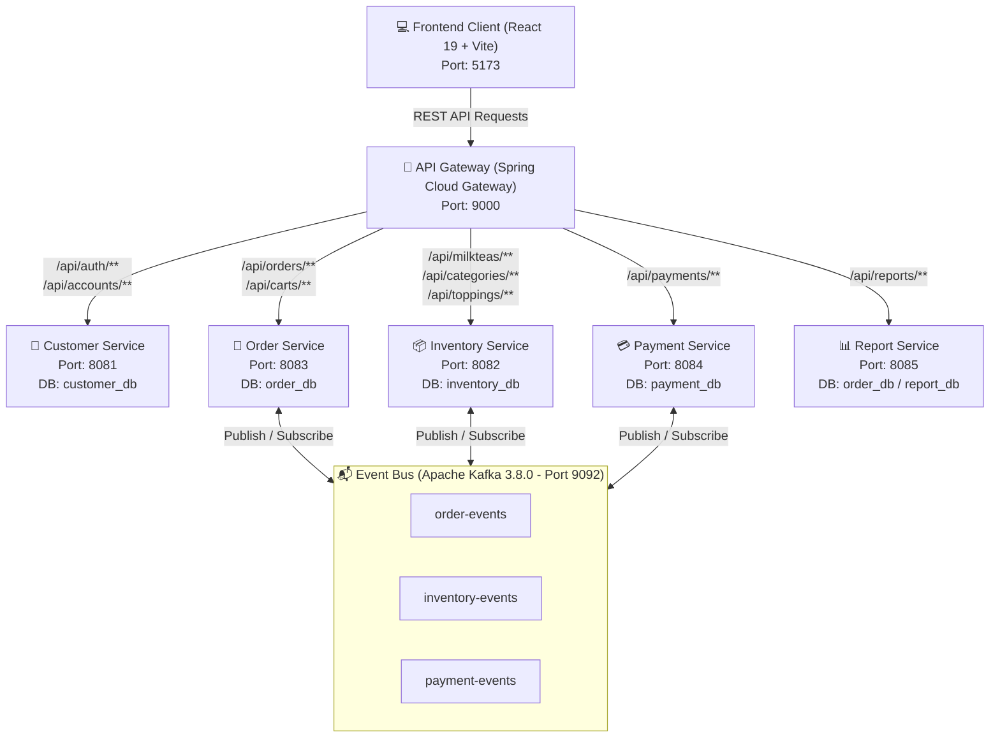
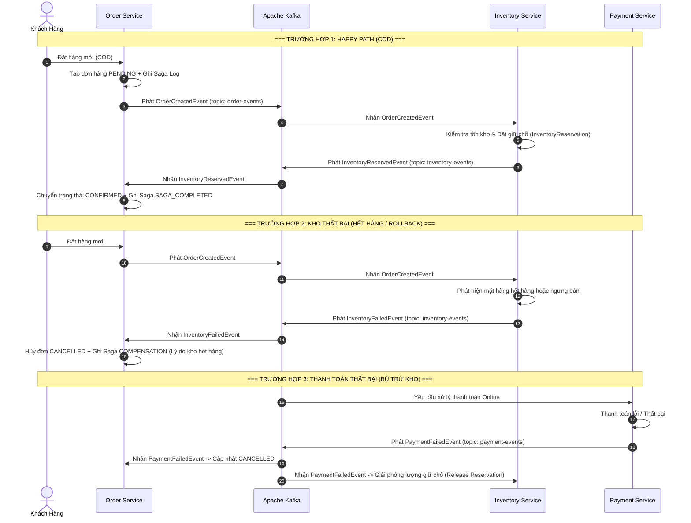

# 🧋 Shop_MilkTea - Hệ Thống Đặt Hàng Trà Sữa Trực Tuyến Phân Tán (Microservices)

> **Đồ án môn học:** MSS301 - Kiến trúc Hướng Dịch vụ (Service-Oriented Architecture & Microservices)  
> **Sinh viên thực hiện:** Nguyễn Thành Long  
> **Mã số sinh viên:** DE190477  

---

## 📌 1. Giới Thiệu Tổng Quan

**Shop_MilkTea** là một hệ thống thương mại điện tử chuyên biệt cho mô hình chuỗi cửa hàng bán lẻ trà sữa trực tuyến. Dự án được thiết kế và triển khai hoàn toàn theo phong cách **Kiến trúc Microservices (Microservices Architecture)** kết hợp với **Kiến trúc Hướng Sự Kiện (Event-Driven Architecture - EDA)**.

Hệ thống giải quyết bài toán giao dịch phân tán phức tạp giữa các dịch vụ độc lập (Đặt hàng - Kho bãi - Thanh toán) bằng cách áp dụng **Mô hình Saga (Saga Choreography Pattern)** thông qua message broker **Apache Kafka**, đảm bảo tính toàn vẹn và tính nhất quán dữ liệu (Data Consistency & Compensation).

---

## 🚀 2. Điểm Nổi Bật & Tính Năng Hệ Thống

### 🍵 Phân Hệ Khách Hàng (Customer Experience)
- **Trang chủ & Giới thiệu:** Giao diện hiện đại, tối ưu trải nghiệm người dùng, tương thích đa thiết bị.
- **Thực đơn linh hoạt:** 
  - Xem danh mục sản phẩm, tìm kiếm và lọc đồ uống.
  - Tùy chỉnh kích cỡ (Nhỏ, Vừa, Lớn) với công thức tính giá theo tỷ lệ size.
  - Tùy chọn nhiều loại Topping ăn kèm (Trân châu đen, Pudding, Thạch củ năng,...).
- **Giỏ hàng thời gian thực:** Quản lý số lượng, tự động tính tổng tiền theo kích cỡ và topping kèm theo.
- **Quy trình đặt hàng & Thanh toán:** Hỗ trợ thanh toán khi nhận hàng (COD) hoặc các hình thức thanh toán trực tuyến.
- **Tra cứu đơn hàng:** Theo dõi lịch sử đơn hàng cá nhân và trạng thái xử lý đơn theo thời gian thực.
- **Xác thực & Bảo mật:** Đăng nhập, đăng ký tài khoản với cơ chế bảo mật JWT Token.

### 🛡️ Phân Hệ Quản Trị Viên (Admin Portal)
- **Dashboard & Báo cáo thống kê:**
  - Tổng quan doanh thu, số lượng đơn hàng, tỷ lệ chuyển đổi, đơn hủy.
  - Biểu đồ xu hướng doanh thu theo mốc thời gian thực.
  - Thống kê Top đồ uống bán chạy nhất (Top-selling products).
  - Phân tích cơ cấu phương thức thanh toán và trạng thái đơn hàng.
- **Quản lý Thực đơn & Kho hàng (Menu & Inventory Management):**
  - Quản lý danh mục (Categories), sản phẩm trà sữa (MilkTeas), kích cỡ (Sizes), và Toppings.
  - Quản lý trạng thái mở bán/ngưng bán, cập nhật giá và thông tin món.
- **Quản lý Đơn hàng & Saga Logs:**
  - Theo dõi danh sách đơn hàng toàn hệ thống với bộ lọc trạng thái đa chiều.
  - **Saga Logs Monitor:** Giám sát chi tiết chuỗi sự kiện giao dịch phân tán Saga theo từng bước (`RESERVE_INVENTORY`, `PROCESS_PAYMENT`, `COMPENSATION`, `SAGA_COMPLETED`).
- **Quản lý Người dùng & Tài khoản:**
  - Quản lý danh sách tài khoản khách hàng và nhân viên.
  - Khóa / Kích hoạt tài khoản, quản lý vai trò người dùng (ADMIN, STAFF, CUSTOMER).

---

## 🏗️ 3. Kiến Trúc Kỹ Thuật (Architecture & Tech Stack)

### 3.1. Công nghệ sử dụng
- **Backend Framework:** Java 21, Spring Boot 4.1.x, Spring Cloud Gateway Server (WebMVC).
- **Database & Persistence:** MySQL 8.4, Spring Data JPA, Hibernate, Flyway Database Migration.
- **Message Broker:** Apache Kafka 3.8 (chế độ KRaft mode độc lập, không phụ thuộc Zookeeper).
- **Authentication & Security:** Spring Security, JSON Web Token (JJWT), BCrypt Password Encoder.
- **Frontend Client:** React 19, Vite 8, React Router v7, Bootstrap 5 & React-Bootstrap, Axios.
- **Containerization & Automation:** Docker, Docker Compose, Windows Batch Scripts (`run.bat`, `stop.bat`).

### 3.2. Sơ đồ Kiến trúc Microservices Tổng Thể



---

## 🔄 4. Mô Hình Giao Dịch Phân Tán Saga Choreography

Hệ thống xử lý tính nhất quán dữ liệu giữa các microservice bằng **Saga Choreography Pattern** qua các Topic của Apache Kafka:



---

## 🗄️ 5. Phân Rã Dữ Liệu & Danh Mục Microservices

Mỗi service áp dụng chặt chẽ mẫu hình **Database-per-Service**, quản lý schema riêng biệt thông qua công cụ di chuyển dữ liệu Flyway:

| Tên Dịch Vụ | Port | Cơ Sở Dữ Liệu | Nhiệm Vụ Trọng Tâm |
| :--- | :---: | :--- | :--- |
| **API Gateway** | `9000` | *Không có* | Định tuyến request, giải mã JWT, forward `X-User-Id`, `X-Username`, `X-User-Role`, cấu hình CORS. |
| **Customer Service** | `8081` | `customer_db` | Đăng ký, đăng nhập, phát hành JWT token, quản lý thông tin tài khoản và vai trò (`ADMIN`, `STAFF`, `CUSTOMER`). |
| **Inventory Service** | `8082` | `inventory_db` | Quản lý danh mục trà sữa, sản phẩm, size, topping, kiểm soát tồn kho và giữ chỗ hàng (`InventoryReservation`). |
| **Order Service** | `8083` | `order_db` | Quản lý giỏ hàng (`Cart`), đơn hàng (`Order`), điều phối quy trình Saga và lưu vết nhật ký `SagaLog`. |
| **Payment Service** | `8084` | `payment_db` | Xử lý thanh toán, lưu vết lịch sử giao dịch và bắn sự kiện thanh toán lên Kafka. |
| **Report Service** | `8085` | `report_db` / `order_db` | Tổng hợp số liệu, cung cấp các API phân tích kinh doanh phục vụ Dashboard quản trị. |
| **Frontend Web** | `5173` | *Client SPA* | Ứng dụng giao diện người dùng React 19 + Vite cho khách hàng và phân hệ quản trị. |

---

## ⚙️ 6. Hướng Dẫn Cài Đặt & Khởi Chạy

### 6.1. Yêu cầu môi trường
- **Java:** JDK 21 trở lên (Khuyến nghị OpenJDK 21 hoặc Oracle JDK 21).
- **NodeJS:** Node.js v20+ và npm.
- **Docker & Docker Compose:** Đã cài đặt Docker Desktop để chạy MySQL và Kafka.

---

### 6.2. Khởi chạy nhanh bằng kịch bản (Khuyến nghị ⚡)

Dự án đã tích hợp sẵn kịch bản tự động hóa khởi động toàn bộ hệ thống:

1. **Khởi động toàn bộ hệ thống (Docker + 5 Backend Services + Frontend):**
   ```cmd
   run.bat
   ```
   *Kịch bản sẽ tự động:*
   - Khởi động Docker containers (MySQL 8.4 trên cổng 3306, Apache Kafka trên cổng 9092).
   - Kiểm tra cổng mạng cho đến khi database và message broker sẵn sàng.
   - Lần lượt khởi động `Customer-Service`, `Inventory-Service`, `Order-Service`, `API-Gateway`, và `Frontend React`.

2. **Dừng toàn bộ hệ thống:**
   ```cmd
   stop.bat
   ```
   *Kịch bản sẽ tự động giải phóng tất cả các cổng mạng (8081, 8082, 8083, 8084, 8085, 9000, 5173) và tắt container Docker an toàn.*

---

### 6.3. Khởi chạy thủ công từng phần (Manual Startup)

Nếu muốn khởi chạy từng thành phần thủ công:

#### Bước 1: Khởi động Hạ tầng Docker (MySQL & Kafka)
```bash
cd Shop_MilkTea_Service
docker compose up -d
```

#### Bước 2: Khởi động các Microservices
Mở từng cửa sổ dòng lệnh tại thư mục tương ứng trong `Shop_MilkTea_Service`:
```bash
# Terminal 1: Customer Service (8081)
cd customer-service
./mvnw spring-boot:run

# Terminal 2: Inventory Service (8082)
cd inventory-service
./mvnw spring-boot:run

# Terminal 3: Order Service (8083)
cd order-service
./mvnw spring-boot:run

# Terminal 4: Payment Service (8084 - nếu cần)
cd payment-service
./mvnw spring-boot:run

# Terminal 5: Report Service (8085 - nếu cần)
cd report-service
./mvnw spring-boot:run

# Terminal 6: API Gateway (9000)
cd api-gateway
./mvnw spring-boot:run
```

#### Bước 3: Khởi động Frontend React
```bash
cd Shop_MilkTea
npm install
npm run dev
```

---

## 🔑 7. Tài Khoản Thử Nghiệm Mặc Định

Tất cả tài khoản thử nghiệm được seed sẵn qua Flyway Migration với mật khẩu mặc định: **`password123`**

| Tên Đăng Nhập | Mật Khẩu | Vai Trò (Role) | Trạng Thái | Mô Tả |
| :--- | :--- | :---: | :---: | :--- |
| `admin_db` | `password123` | **ADMIN** | `ACTIVE` | Toàn quyền quản trị hệ thống, menu, đơn hàng, tài khoản, thống kê. |
| `staff1` | `password123` | **STAFF** | `ACTIVE` | Tài khoản nhân viên vận hành cửa hàng. |
| `customer1` | `password123` | **CUSTOMER** | `ACTIVE` | Tài khoản khách hàng thông thường để đặt món. |
| `customer2` | `password123` | **CUSTOMER** | `ACTIVE` | Tài khoản khách hàng kiểm thử số 2. |
| `inactive_user` | `password123` | **CUSTOMER** | `INACTIVE` | Tài khoản mô phỏng trường hợp chưa kích hoạt hoặc bị khóa. |

---

## 🌐 8. Các Đường Dẫn Truy Cập Chính

Sau khi khởi chạy hệ thống, có thể truy cập các địa chỉ sau:

- 🏠 **Trang Chủ Khách Hàng:** [http://localhost:5173](http://localhost:5173)
- 📜 **Thực Đơn Món Ăn:** [http://localhost:5173/menu](http://localhost:5173/menu)
- 🛒 **Giỏ Hàng:** [http://localhost:5173/cart](http://localhost:5173/cart)
- 📦 **Lịch Sử Đơn Hàng:** [http://localhost:5173/orders](http://localhost:5173/orders)
- 📊 **Admin Dashboard Thống Kê:** [http://localhost:5173/admin/dashboard](http://localhost:5173/admin/dashboard)
- 📋 **Admin Quản Lý Thực Đơn:** [http://localhost:5173/admin/menu](http://localhost:5173/admin/menu)
- 📑 **Admin Quản Lý Đơn Hàng & Saga Logs:** [http://localhost:5173/admin/orders](http://localhost:5173/admin/orders)
- 👥 **Admin Quản Lý Tài Khoản:** [http://localhost:5173/admin/accounts](http://localhost:5173/admin/accounts)
- 🌐 **API Gateway Root:** [http://localhost:9000](http://localhost:9000)

---

## 📁 9. Cấu Trúc Thư Mục Dự Án (Project Structure)

```text
DE190477_MSS301_project/
├── run.bat                          # Script 1-click khởi động toàn bộ hệ thống
├── stop.bat                         # Script 1-click dừng toàn bộ hệ thống
├── README.md                        # Tài liệu mô tả dự án
│
├── Shop_MilkTea/                    # Frontend Application (React 19 + Vite)
│   ├── src/
│   │   ├── component/               # Reusable UI components (Navbar, Footer, Modals, Cards)
│   │   ├── context/                 # State management Context API (Auth, Cart, Order, Inventory)
│   │   ├── layout/                  # Master layouts (MainLayout, AdminLayout)
│   │   ├── page/                    # Các trang người dùng (Landing, Menu, Cart, Orders)
│   │   │   └── admin/               # Các trang Admin (Dashboard, Menu, Orders, Accounts)
│   │   ├── router/                  # Cấu hình định tuyến React Router v7 (AppRouter)
│   │   └── service/                 # Axios HTTP client gọi API qua API Gateway
│   ├── package.json
│   └── vite.config.js
│
└── Shop_MilkTea_Service/            # Backend Microservices (Spring Boot)
    ├── docker-compose.yml           # Khởi tạo MySQL 8.4 và Apache Kafka 3.8
    ├── mysql/
    │   └── init.sql                 # Script khởi tạo 5 database độc lập
    ├── api-gateway/                 # Spring Cloud Gateway (Port 9000)
    ├── customer-service/            # Customer & Authentication Service (Port 8081)
    ├── inventory-service/           # Inventory & Catalog Service (Port 8082)
    ├── order-service/               # Order & Saga Orchestration Service (Port 8083)
    ├── payment-service/             # Payment Processing Service (Port 8084)
    └── report-service/              # Reporting & Analytics Service (Port 8085)
```

---

## 👨‍💻 10. Thông Tin Tác Giả & Bản Quyền

- **Họ và tên:** Nguyễn Thành Long
- **Mã sinh viên:** DE190477
- **Học phần:** MSS301 - Kiến trúc Hướng Dịch vụ
- **Trường:** Đại học FPT
- **Bản quyền:** © 2026 DE190477 - Nguyễn Thành Long. Dự án phục vụ mục đích học tập và nghiên cứu.
